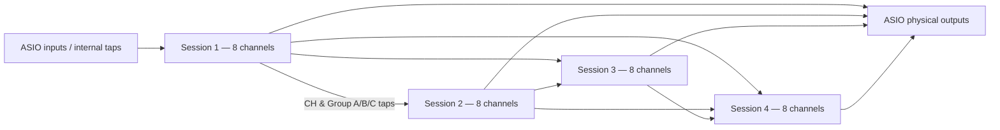

# SpeechShare

**Real-time gain-sharing automixer for broadcast, live sound and post-production.**

[](https://github.com/GodzDanielito/SpeechShare---Dugan-Automixer/actions/workflows/dsp-tests.yml)


[](LICENSE)

**[Guida in italiano](README.it.md)** · [Build guide](docs/BUILD.md) · [DSP & architecture](docs/ARCHITECTURE.md) · [Italian technical manual (PDF)](docs/manuals/SpeechShare_PHON_Modular_4Session_Manuale_Tecnico_Uso_v0.3.1.pdf) · [Known limitations](docs/KNOWN_LIMITATIONS.md)

SpeechShare is an experimental C++ audio processor built around a *gain-sharing* algorithm. Rather than independently gating every microphone, it allocates relative gain across sources in the same group. SpeechShare is **inspired by established gain-sharing techniques**; it is **not an official Dan Dugan, Waves, Yamaha or Audinate product**, nor a mathematical clone of their proprietary implementations.

> **Important:** This is a research/prototype release, **not validated for unattended, safety-critical or on-air broadcast operation**. An active investigation concerns glitches observed in a Dante Virtual Soundcard / Windows ASIO setup. See [Known limitations](docs/KNOWN_LIMITATIONS.md). Use monitoring safeguards and a bypass/fallback path.

## Available editions

| Edition | Version | Purpose | Features |
|---|---|---|---|
| **PHON Modular 4** | **v0.3.1** | Standalone Windows audio processor | 4 sessions × 8 participants; mono/stereo ASIO patching; A/B/C group buses; forward-only internal routing; Auto Session Sleep; callback load meter |
| **Insert PHON** | **v0.1.5** | Per-track VST3 for DAWs | SharedPool coordination; 8 selectable sessions; up to 32 instances total; track names from REAPER; Classic/Smart; group keys; PHON GUI |

The DAW Insert edition **does not** include the standalone ASIO device panel, modular patch, group-bus hardware routing, or Overview page. Both editions share the main gain-sharing DSP architecture, but are delivered as **separate CMake projects**, not a single library or executable.

### Feature overview

- Shared-gain automixing: **Classic** (RMS-weighted gain allocation) and **Smart** (fast/slow power and noise-floor heuristic).
- **PHON** macro, 0–100: one control for Strength, Attack and Release; neutral preset at 50.
- Per-channel **Weight**, Mute, Solo, Auto/Manual/Bypass and group A/B/C assignment.
- **Virtual KEY** per group; generator supports sine and pink-noise detector signals (not routed to the program output).
- Stereo linked detection and gain; one stereo pair consumes one participant slot.
- 48 kHz broadcast workflows supported when the host/ASIO interface supports that sample rate.

## Architecture at a glance



In the modular edition, internal taps only flow **from earlier to later sessions**. The four sessions are processed in a defined order within the same ASIO callback. This avoids adding a whole-block transfer buffer between sessions, **but does not mean zero end-to-end latency**.

## Quick start — Windows

Prerequisites: CMake 3.22+, Visual Studio with C++ desktop tools, the JUCE source tree installed separately (historically tested with JUCE 8 at `C:\JUCE`), an ASIO driver for standalone use, and a supported 64-bit VST3 host for the plugin. **JUCE is not vendored in this repository.** Licensing of JUCE is independent: [JUCE licensing](https://github.com/juce-framework/JUCE/blob/master/LICENSE.md).

**Standalone (4 sessions)**

```powershell
cd apps\modular-4
powershell -ExecutionPolicy Bypass -File .\build_live_windows_2026.ps1
```

**DAW Insert VST3**

```powershell
cd plugins\insert-vst3
powershell -ExecutionPolicy Bypass -File .\build_insert_windows_2026.ps1
```

Both scripts default to `C:\JUCE`. Open the respective script to change this or use the corresponding `-JuceRoot` option where supported. Before inserting any application in a real audio chain, verify driver ownership, device clock, sample rate and physical output assignments. Do not test feedback-capable routings with loudspeakers open.

**Run the source-level tests without JUCE:**

```bash
cmake -S apps/modular-4 -B build/modular -DSPEECHSHARE_LIVE_BUILD_APP=OFF
cmake --build build/modular --config Release
ctest --test-dir build/modular -C Release --output-on-failure

cmake -S plugins/insert-vst3 -B build/insert -DSPEECHSHARE_BUILD_PLUGINS=OFF
cmake --build build/insert --config Release
ctest --test-dir build/insert -C Release --output-on-failure
```

**Tests do not prove real-time glitch-free ASIO performance.** The CI checks JUCE-independent C++ logic only. Full Windows JUCE builds and real hardware validation must be completed separately.

## Repository structure

```text
SpeechShare/
├── apps/modular-4/               # Standalone application v0.3.1
│   ├── App/                       # ASIO driver, callback, routing graph, UI shell
│   ├── Insert/                    # Shared participant DSP / editor
│   ├── Tests/                     # 7 headless C++ test targets
│   └── build_live_windows_2026.ps1
├── plugins/insert-vst3/          # Per-track VST3 v0.1.5
│   ├── Insert/                    # Insert GUI, DSP, SharedPool and PHON
│   ├── Source/                    # Existing legacy Multitrack/Stereo targets
│   ├── Tests/                     # 5 headless C++ test targets
│   └── build_insert_windows_2026.ps1
├── docs/                         # Build, DSP, validation, troubleshooting
├── .github/                      # CI and contribution templates
└── LICENSE                       # MIT for SpeechShare-owned source only
```

## Documentation

- [Installation, configuration and compiling](docs/BUILD.md)
- [Audio routing, DSP and equations](docs/ARCHITECTURE.md)
- [Operational validation checklist](docs/VALIDATION.md)
- [Known limitations and troubleshooting](docs/KNOWN_LIMITATIONS.md)
- [Licensing, trademarks and third-party notices](docs/LEGAL_AND_BRANDING.md)
- [Italian user/technical manual](docs/manuals/SpeechShare_PHON_Modular_4Session_Manuale_Tecnico_Uso_v0.3.1.pdf)
- [Changelog](CHANGELOG.md) · [Roadmap](docs/ROADMAP.md)

## Licensing and project status

SpeechShare-authored C++ source code is provided under the [MIT License](LICENSE), consistent with the notice in the existing Insert prototype. **JUCE, drivers, SDKs and trademarks have independent terms.** The Backstage signature logo included for build compatibility is **not** granted under the MIT License; confirm that you have permission to publish it before making this repository public. See the [legal/branding checklist](docs/LEGAL_AND_BRANDING.md).

No JUCE sources, proprietary Dugan/Waves components, Dante SDKs, Windows ASIO drivers, recorded multitrack audio or personal machine configuration files are included.

Contributions and bug reports are welcome; see [CONTRIBUTING.md](CONTRIBUTING.md) and [SECURITY.md](SECURITY.md).
